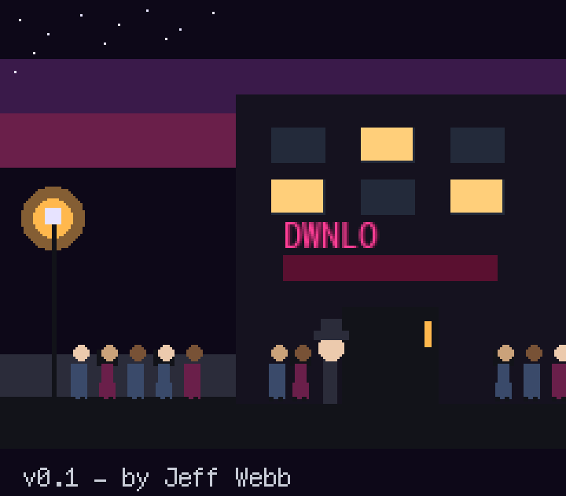
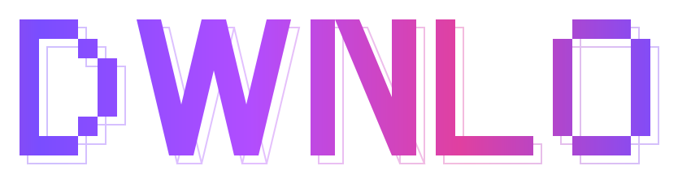
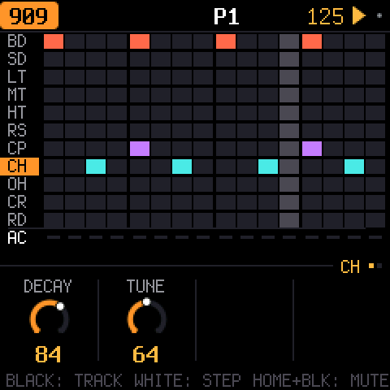
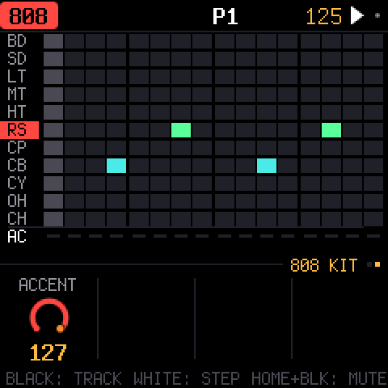
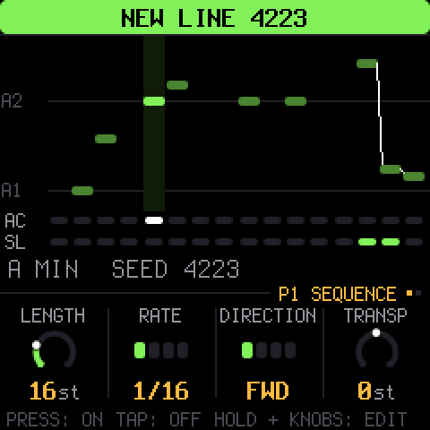
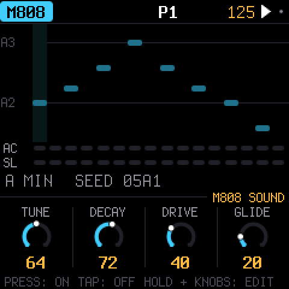
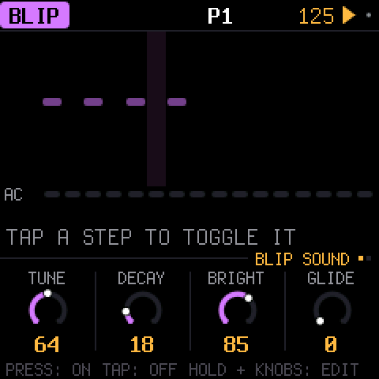
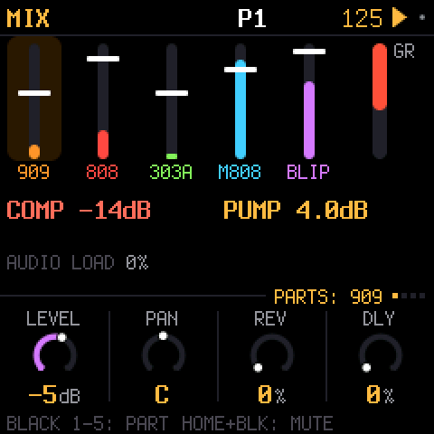

<div align="center">





**Drum Machine & Synthesizer Firmware for M-VAVE FM-1**


</div>

DWNLO is custom firmware for the M-VAVE FM-1. It runs five parts: **909**, **808**, **303**,
**808 Bassline**, **BLIP**. Each part has its own pattern and step length, up to 64 steps. All
five parts play at once. Patterns chain into songs. Knob moves can be recorded. Audio output is
stereo, with a shared reverb, tape delay and master compressor. Over USB the FM-1 presents as
both a MIDI device and an audio input; no driver is required.

**Use at your own risk.** This is unofficial, unsupported firmware. If it fails to boot
repeatedly, it enters a safe mode; USB remains active in safe mode, for reinstalling. If the
device becomes unresponsive beyond that, `tools/fm1_rescue.sh` restores stock M-VAVE firmware
from a Mac. There is no web installer. Install from the command line (below).

## Parts

| Part | What it is | Based on |
|---|---|---|
| 909 | 11 voices: modelled kick, snare, toms, rim and clap, with sampled hats and cymbals | [9W9](https://github.com/athousanddetails/schwung-9W9) (samples from ER-99) |
| 808 | 11 tracks, including the 808's tom/conga, rim/claves and clap/maracas switches | [8W8](https://github.com/athousanddetails/schwung-8W8) |
| 303 | Open303 with Devilfish-style ranges, with a TB-3PO line generator | [schwung-303](https://github.com/charlesvestal/schwung-303), [schwung-tb3po](https://github.com/charlesvestal/schwung-tb3po) |
| 808 Bassline | A from-scratch bass voice, modelled after the kit's 808 sound | DWNLO |
| BLIP | A monophonic 2-operator FM synth voice. Modulator envelope decays faster than the carrier envelope, for a bright attack. Includes a one-pole lowpass filter with its own LFO | DWNLO |

## Screens

Screenshots are generated by the host simulator (`tools/gen_readme_screens.sh`) and show one bar,
looped, of a 4/4 pattern programmed through the panel: kick on the downbeat, clap on beats 2 and
4, closed hats on the upbeat.

<table>
<tr>
<td align="center" width="33%"><br>The step sequencer: kick on the beat, clap on 2 and 4, hats on the upbeat.</td>
<td align="center" width="33%"><br>The 808's page: cowbell and rim.</td>
<td align="center" width="33%"><br>The 303's page: a TB-3PO generated line.</td>
</tr>
<tr>
<td align="center" width="33%"><br>The 808 Bassline's page: tune, decay, drive, glide.</td>
<td align="center" width="33%"><br>BLIP's page: tune, decay, bright, glide.</td>
<td align="center" width="33%"><br>Mixer: levels, sends, compressor.</td>
</tr>
</table>

## Features

- Five parts: 909, 808, 303, 808 Bassline, BLIP. Each has its own pattern and step length, up to
  64 steps. Patterns chain into a song.
- Knob moves can be recorded as motion. Holding a step and turning a knob p-locks that step to
  its own value. Holding a step and turning SELECT sets its probability (5-100%) or a fixed play
  cycle (1:2, 2:2, 1:3, etc.).
- TB-3PO line generator for the 303. OCT+ generates a new line; OCT- mutates the current line.
  Parameters: density, accent, slide, octave range, scale, root.
- Undo and redo (HOME+REC / HOME+PLAY) apply to every edit, tracked by difference. Autosave
  writes changes automatically while the sequencer is stopped and idle.
- Project backup and restore to a file, over USB, from the command line or a browser.
- USB: the FM-1 presents as a MIDI device and an audio input at the same time. External MIDI
  clock is supported.
- Stereo signal path: shared reverb, tape delay, master compressor with PUMP.
- Screen reader support (fm1-reader) over USB.
- Drum step grid: one fixed colour per track row, distinct accent row, sharp rectangles. Each
  part's knob page has its own colour theme.
- On patterns longer than 16 steps, the LCD grid and keybed white-key LEDs follow the playhead's
  current page during playback. Hold OCT+ and tap OCT- (or the reverse) to disable this.
- Custom boot splash (`firmware/src/dwnlo_splash.c`): an animated scene with a car and flashing
  windows. The GIF above is a redraw of its layout and timing, not a device capture.

## Building and testing

[BUILDING.md](BUILDING.md) explains the toolchain. In short:

```sh
tests/run_tests.sh      # the maths, the sequencer, every engine against its original, the app in a simulator
./build.sh               # build/dwnlo.fwsc
```

`host/x0x_host` runs the application on a computer from a script (`tests/scenarios/*.x0x`).
Script input: button presses, keys, knob turns, MIDI. Output: audio and screenshots. Most of
DWNLO is verified this way before testing on hardware.

## Installing

```sh
pip3 install mido python-rtmidi
python3 tools/fm1_install.py build/dwnlo.fwsc
python3 tools/fm1_install.py --info          # identity of the connected FM-1
```

Installing firmware is at your own risk, see the warning above. BUILDING.md has the full
install flow, including how to run the web installer from a local copy for Chrome or Edge.

## Layout

```
firmware/src/app/     UI, sequencer glue, the five parts' dispatch, platform code
firmware/src/dsp/     the engines themselves (drum909, drum808, bass303, bass808m, blip, fxbus, master)
firmware/src/seq/     the sequencer, patterns, TB-3PO, motion recording
firmware/hal/         Felucca's hardware layer (timers, USB, flash, the panel)
host/                 the host simulator: the whole app, run from a script instead of the chip
tools/                build, packaging, install, and asset-generation scripts
tests/                the host-simulator test suite and its scenario scripts
web/                  the browser/WASM emulator and the web installer
```

## Licence and credits

DWNLO is a fork of [X0X](https://github.com/charlesvestal/fm1-x0x), itself a fork of
[Felucca](https://github.com/hugelton/Felucca).

DWNLO is GPL-3.0-only, like X0X, Felucca, 9W9, 8W8 and schwung-tb3po. Open303 (by Robin Schmidt)
is MIT. The 909's hi-hat, ride and crash samples come from ER-99 (Matthew Cieplak, GPL-3.0). The
fonts are Barlow Semi Condensed and Terminus (SIL OFL 1.1). [LICENSING.md](LICENSING.md) has the
full per-file table, including exactly what DWNLO changed on top of X0X.

The second core follows what keremimo's [Melodee](https://github.com/keremimo/melodee) found on
the device (how to start it, the jobs done kept in a register), with zednaked's
[Jangada](https://github.com/zednaked/jangada) measurements and mailbox layout. The boot splash's
baked-bitmap technique follows SLOOP's convention (Chance Roth); no code copied from it.

Felucca's own assets that aren't under its GPL (the icon set, the panel photo and the Hügelton
drum pack) aren't part of this fork.
